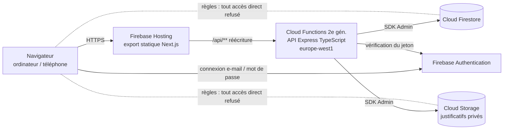
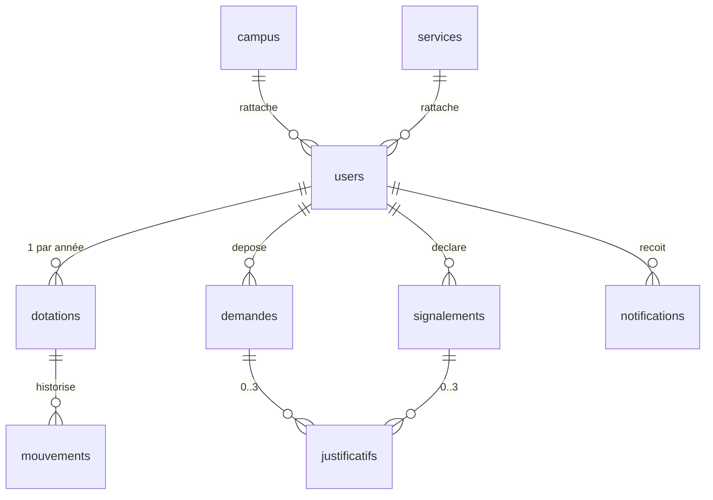

# Rapport de stage — Application de gestion des congés, absences et retards

**Maroc Ynov Campus — Stage interne 2026**
Étudiant : ZERKDI Lahoucine (Bachelor 2) · Encadrant : Mounir BAALI, chef de projet · Remise : 14 octobre 2026, 23 h 59 (heure du Maroc)

> Document de travail à compléter et relire par l’étudiant (captures d’écran, retours de l’encadrant, date de présentation). Les paramètres RH indiqués « à confirmer » doivent être validés avec l’encadrant.

---

## 1. Contexte et besoin

Le suivi des congés, des absences et des retards du personnel repose aujourd’hui sur des échanges dispersés (courriels, documents, messages). L’objectif est de **centraliser** ces demandes dans une application web interne permettant :

- à chaque collaborateur de consulter ses droits et son solde, de demander un congé, de déclarer une absence ou un retard et de joindre un justificatif ;
- au responsable hiérarchique (N+1) de refuser les demandes de congé de son équipe ou de les transmettre aux RH avec son avis, et de prendre connaissance des signalements ;
- au service RH de décider, d’examiner les justificatifs, de qualifier les signalements, de gérer les droits annuels et de suivre l’activité ;
- à l’administrateur de gérer les comptes, rôles et rattachements.

Contraintes transverses : rôles et périmètres stricts, **confidentialité des justificatifs** (notamment médicaux), **traçabilité** de toutes les décisions, interface **responsive en français**, dates dans le fuseau **Africa/Casablanca**, application déployée pour démonstration avec des **données fictives**.

Hors périmètre (cahier des charges) : paie et retenues, badgeuse, intégration SIRH, acquisition automatique des droits et report d’une année sur l’autre ; courriels métier et synchronisation d’agenda en option.

## 2. Règles RH retenues

| Règle | Mise en œuvre | Statut |
|---|---|---|
| Dotation annuelle | 18 jours par collaborateur et par année, **paramétrable** (valeur par défaut) et modifiable par les RH pour un collaborateur et une année | À confirmer |
| Calendrier de travail | Jours ouvrés du lundi au vendredi ; jours fériés marocains 2026–2027 préchargés (fêtes religieuses à confirmer chaque année) ; tout est modifiable dans *RH › Paramètres* | À confirmer |
| Unité | Journée ou demi-journée (début l’après-midi / fin à midi) | Retenu |
| Solde | Droits attribués ± ajustements − jours **payés** des demandes approuvées non annulées ; demandes en attente affichées à part | Conforme au sujet |
| Solde insuffisant | Proposition des jours non couverts en congé **non payé**, avec dates de chaque partie, et **accord explicite** obligatoire ; aucune conversion automatique | Conforme |
| Répartition | Les premiers jours ouvrés de la période sont payés tant que le solde le permet (une journée peut être scindée en ½ payée + ½ non payée) | Choix de conception |
| Solde de référence de la proposition | Solde disponible diminué des jours payés déjà engagés dans d’autres demandes en attente (« solde prévisionnel ») pour éviter les mauvaises surprises au moment de la décision | Choix de conception |
| Types de congé | Congé payé (décompté du solde) ; congé sans solde (entièrement non payé) | Extensible |
| Circuit | brouillon → soumise → (refus du responsable **ou** avis transmis) → en décision RH → approuvée / refusée ; annulée. Sans responsable désigné : passage direct en décision RH | Conforme (refus N+1 ajouté à la demande de l’encadrant) |
| Annulation après approbation | Demandée par le collaborateur, **décidée par les RH** ; restitution unique des jours payés ; après le début du congé : régularisation RH motivée | Conforme |
| Année civile | Une demande traversant deux années est **scindée en deux demandes** | Conforme |
| Motifs d’absence / retard | Maladie, enfant malade (médicaux) ; événement familial, démarche administrative (pièce attendue sous 5 j) ; force majeure, autre (pièce non requise) ; retards : transport, rendez-vous médical, autre | À confirmer |
| Justificatifs | PDF, JPEG, PNG ; 10 Mo ; 3 pièces par dossier | Conforme (limite proposée) |

## 3. Architecture

### 3.1 Vue d’ensemble

- **Frontend** : Next.js 16 + TypeScript, `output: 'export'` (pages statiques servies par Firebase Hosting). Aucune Server Action ni rendu serveur à la requête. Les pages de détail utilisent un paramètre d’URL (`/conges/detail?id=…`) : elles affichent donc les dossiers créés après le déploiement.
- **Backend** : une Cloud Function HTTP `api` (2ᵉ génération, région Belgique la plus proche du Maroc) qui héberge une API Express structurée en couches :
  - `domain/` : règles **pures** et testées (calendrier, solde et répartition, autorisations, circuit, contrôle de fichiers) ;
  - `services/` : opérations métier en **transactions Firestore** (demandes, signalements, dotations, justificatifs, historique, notifications) ;
  - `routes/` : validation des entrées (zod) et exposition HTTP ;
  - `middleware/` : authentification à chaque requête.
- **Même origine** : Hosting transmet `/api/**` à la fonction ; pas de CORS en production.

### 3.2 Choix du backend : Cloud Functions plutôt que NestJS / Cloud Run

| Critère | Cloud Functions for Firebase | NestJS + Docker sur Cloud Run |
|---|---|---|
| Faisabilité dans le délai | Élevée : intégré à Firebase CLI, émulateur local | Moyenne : Dockerfile, registre d’images, configuration Cloud Run |
| Maîtrise | TypeScript + Express, connus | Framework supplémentaire à maîtriser (modules, DI, décorateurs) |
| Déploiement | `firebase deploy` unique (hosting + fonctions + règles) | Deux chaînes (Firebase + gcloud/Docker) |
| Développement local | Suite d’émulateurs complète (Auth, Firestore, Storage, Functions, Hosting) | Émulateurs Firebase + conteneur local |
| Évolutivité | Suffisante pour l’usage (quelques centaines d’utilisateurs) ; l’app Express est portable vers Cloud Run si besoin | Plus adaptée à une grosse API |

Le code Express (`creerApp()`) est indépendant de Cloud Functions : il pourrait être empaqueté dans un conteneur Cloud Run sans réécriture.

### 3.3 Principes de sécurité

- **Contrôle côté serveur systématique** : jeton vérifié (avec révocation), compte actif, rôle et périmètre pour chaque opération. Le profil est relu à chaque requête : une désactivation ou un changement de rôle prend effet immédiatement.
- **Règles Firestore et Storage fermées** (`allow read, write: if false`) : le navigateur ne peut ni lire ni écrire directement ; seule l’API (SDK Admin, non soumis aux règles) accède aux données, conformément à la recommandation du sujet [R4].
- **Séparation des droits** : personne ne valide sa propre demande ni ne modifie ses propres droits, même en cumulant les rôles ; l’administrateur n’accède à aucun dossier ni justificatif.
- **Confidentialité** : justificatifs privés, téléchargés uniquement via l’API après contrôle (en-têtes `no-store`, `nosniff`) ; aucune URL publique ; motif et commentaire médicaux masqués au responsable ; notifications et planning sans contenu médical.
- **Intégrité des soldes** : toutes les écritures de solde dans des transactions lisant la dotation (sérialisation par collaborateur et par année) ; indicateurs `debitEffectue` / `restitutionEffectuee` ; clé d’idempotence contre les doubles soumissions.
- **Traçabilité** : historique et mouvements en **ajout seul**, écrits dans la même transaction que l’action ; auteur, date serveur et motif.
- **Validation** : schémas zod sur toutes les entrées, type réel des fichiers vérifié par signature binaire, CSV protégé contre l’injection de formules.
- **Secrets** : aucun secret dans le dépôt ni dans le frontend (configuration web via `.env.local`, compte de service par défaut pour les fonctions) ; en-têtes HTTP de sécurité sur Hosting.

## 4. Modèle de données (Cloud Firestore)

| Collection | Champs principaux | Remarques |
|---|---|---|
| `users/{uid}` | email, nom, prénom, fonction, `roles[]` (collaborateur, responsable, rh, direction, admin), `campusId`, `serviceId`, `managerId`, `actif`, `perimetreRh {tous, campusIds[]}` | uid = identifiant Firebase Auth |
| `campus/{id}`, `services/{id}` | nom | Référentiels |
| `parametres/general` | dotationParDefaut, joursOuvres, joursFeries, catégories de motifs, limites des justificatifs | Modifiable par RH global (motivé, historisé) |
| `dotations/{uid}_{année}` | joursAttribues, ajustements, joursDebites, + rattachement | Compteurs agrégés par année (jamais écrasés d’une année sur l’autre) |
| `mouvements/{id}` | userId, année, type (DOTATION_INITIALE, MODIFICATION_DOTATION, AJUSTEMENT, DEBIT, RESTITUTION), jours (±), motif, auteur, date, demandeId, soldeApres | Ajout seul : justifie chaque variation de solde |
| `demandes/{id}` | type, année, dateDebut/dateFin, demi-journées, statut, **dureeTotale, joursPayes, joursNonPayes, plagesPayees[], plagesNonPayees[]**, accordNonPaye, avis, decision, annulation, reconfirmationRequise, debitEffectue, restitutionEffectuee, groupeId (scission), intérim, **signatures {employe, raf, direction}** (visas serveur), ficheNumero, ficheStatut, ficheSel (sel du code de vérification), + rattachement (userId, managerId, campusId, serviceId) | Répartition payée / non payée stockée avec les dates |
| `signalements/{id}` | type (absence/retard), catégorie, médical, dates, durée estimée, retard {heurePrevue, estimée, réelle, minutes}, `declareLe`, aPosteriori, **statutTraitement** (déclaré / en cours / clôturé), **qualification** (à examiner / justifié / non justifié), **justificatifStatut** (non requis / à fournir / reçu / accepté / refusé), échéance, priseConnaissance, décision | Deux axes distincts conformément au sujet |
| `justificatifs/{id}` | dossierType, dossierId, chemin Storage, nom, type, taille, médical, statut, motif de décision, + rattachement | Le fichier est dans Storage (`justificatifs/{uid}/{dossier}/{id}.ext`) ; seules les métadonnées sont en base |
| `notifications/{id}` | userId, titre, message (sans contenu médical), lien vers le dossier, `lu` | État lu / non lu |
| `historique/{id}` | entité, entiteId, action, résumé, motif, détails (avant/après), auteur, date | Ajout seul |
| `idempotence/{uid}_{clé}` | ids créés | Anti double soumission |

Les champs de rattachement copiés sur les dossiers permettent de filtrer par équipe ou par campus ; ils sont mis à jour quand l’administrateur modifie le rattachement d’un collaborateur. 70 index composites (`firestore.indexes.json`) couvrent les listes filtrées et paginées.

## 5. Réalisations

| Exigence du sujet | Réalisation |
|---|---|
| Connexion e-mail / mot de passe, récupération, désactivation, pas d’inscription publique | Page de connexion, « Mot de passe oublié » (message neutre), comptes créés par l’administrateur (lien de définition du mot de passe), désactivation Auth + révocation des sessions |
| Attribution annuelle, consultation du solde | Dotation créée automatiquement (18 j) à la création du compte ou au premier besoin ; attribution en lot par les RH ; espace « Mes congés » (année, attribués, décomptés, ajustements, solde, en attente, mouvements) |
| Demandes et décisions, proposition de non payé | Simulation serveur avant envoi, récapitulatif daté, accord explicite, brouillon, circuit complet, refus motivé, reconfirmation si le solde a changé |
| Formulaire F031 en ligne (demande de l’encadrant) | La demande se remplit directement sur le formulaire « Demande de congé » F031/DI : identité issue du compte (non modifiable), jours ouvrables, date de reprise et reste acquis calculés par le serveur, intérim. Trois **visas électroniques** horodatés apposés par le serveur : employé (case de certification obligatoire), RAF (gestionnaire RH qui approuve) et direction régionale (nouveau rôle, accord ou refus motivé qui annule le congé et restitue les jours). Cases RAF / direction verrouillées pour tout autre profil ; fiche en ligne et PDF (filigrane tant qu’elle n’est pas complète) ; **code de vérification** anti-falsification et page « Vérifier une fiche » |
| Compléments au sujet | Modification d’un brouillon ; imputation d’une absence sur le solde de congés « sous réserve de validation hiérarchique » (prise de connaissance du responsable, motif, une seule fois) ; alerte aux administrateurs lorsqu’aucun valideur RH ou signataire de direction n’est disponible |
| Annulation / régularisation | Demande d’annulation par le collaborateur, décision RH, restitution unique, traçage « régularisation » après le début |
| Signalements d’absence et de retard | Déclaration immédiate ou a posteriori, date de fin complétable, arrivée réelle et durée calculée, corrections motivées, prise de connaissance, traitement RH distinct |
| Justificatifs | Dépôt contrôlé, stockage privé, examen RH (accepté / refusé motivé + complément), échéance visible |
| Tableaux de bord par rôle, filtres, planning, export CSV | Tableau de bord adapté, listes filtrées (statut, type, période) et paginées, planning mensuel des congés approuvés, export CSV RH tracé |
| Notifications et historique | Notifications à la soumission, à la demande de complément et à chaque décision (lu / non lu, lien) ; historique horodaté de chaque dossier |
| Rattachements et séparation des droits | Campus, service, responsable ; périmètres RH par campus ; interdiction de s’auto-valider |
| Responsive, français, identité Ynov | Charte noir / blanc / turquoise, logo, Montserrat auto-hébergée, menu mobile, listes en cartes sur téléphone |

### 5.1 Sécurité renforcée

Voir `docs/SECURITE.md` : règles Firestore/Storage fermées, contrôles serveur systématiques, administrateur sans auto-attribution de rôle, mots de passe robustes, limitation de débit et taille des requêtes, en-têtes CSP/HSTS/COOP, App Check prêt à activer, déconnexion après inactivité, traçage des consultations de justificatifs et des refus d’accès, dépendances sans vulnérabilité connue (`npm audit`), notice de protection des données (loi 09-08).

## 6. Tests et qualité

- **49 tests unitaires** (`functions/test/unit`) : calendrier, solde et répartition (dont l’exemple 18/16/4 du sujet), autorisations (périmètres, séparation des droits, administrateur), circuit, fichiers, CSV, fiche de congé PDF.
- **43 tests d’intégration** (`functions/test/integration`) qui rejouent **tous les scénarios minimum du §6** sur l’API réelle et les émulateurs (voir `docs/RECETTE.md`).
- **Recette d’interface** : parcours complets rejoués automatiquement dans Chromium (collaborateur → responsable → RH → administrateur, ordinateur et téléphone), plus une grille de recette manuelle.
- **Qualité** : TypeScript strict (frontend et API), ESLint (règles Next.js et React), CI GitHub Actions (lint, types, build, tests, Semgrep).
- Les tests ont été vérifiés en introduisant volontairement des défauts (double débit, accès aux justificatifs ouvert) : ils échouent bien.

## 7. Déploiement et exploitation

Procédure complète dans le `README` : installation, démarrage local avec émulateurs et données fictives, configuration, `npm run deploy`, création du premier administrateur, **retour arrière** (restauration d’une version Hosting en un clic, redéploiement d’une étiquette Git pour l’API et les règles).

## 8. Limites connues

- Pas d’annulation partielle d’un congé approuvé (annulation totale puis nouvelle demande) ; la direction accorde la période approuvée telle quelle (ou la refuse).
- L’imputation d’une absence sur les congés se fait année par année (absence à cheval sur deux années : ajustement RH).
- Les RH ne peuvent décider qu’après l’avis du responsable, qui peut aussi refuser seul la demande ; si le responsable est indisponible, l’administrateur doit désigner un autre responsable.
- Comptes : premier super-administrateur créé une seule fois depuis la page *Installation* (clé secrète) ; les autres comptes reçoivent un mot de passe provisoire par e-mail (72 h) et choisissent leur mot de passe personnel à la première connexion. L’envoi d’e-mails nécessite un serveur SMTP de l’établissement.
- Les jours fériés religieux sont des estimations à confirmer chaque année.
- Les notifications sont uniquement dans l’application (pas de courriel ni de rappel automatique, optionnels dans le sujet).
- Les gros volumes d’export sont limités à 5 000 lignes par fichier.
- Les tests d’intégration nécessitent Java (émulateur Firestore) ; ils sont exécutés en CI.

## 9. Pistes d’amélioration

Courriels de notification et rappels d’échéance de justificatif (fonction planifiée), synchronisation d’agenda, types de congés exceptionnels (mariage, naissance, décès) avec quotas, report automatique des droits, authentification Google Workspace / SSO, App Check, tableau de bord statistique (taux d’absentéisme), purge automatique des justificatifs après la durée de conservation légale, internationalisation.

## 10. Estimation du coût de mise en production

### 10.1 Services nécessaires

| Service | Usage | Forfait |
|---|---|---|
| Firebase Hosting | Frontend statique (~2 Mo par premier chargement, mis en cache ensuite) | Quota gratuit 10 Go stockés, 10 Go/mois transférés |
| Cloud Functions (2ᵉ gén.) | API (`api`, 512 Mio) | Blaze : 2 M invocations, 400 000 Go·s, 200 000 s·CPU et 5 Go sortants gratuits par mois |
| Cloud Firestore | Données métier | 50 000 lectures, 20 000 écritures, 20 000 suppressions **par jour** et 1 Gio stocké gratuits ; au-delà ≈ 0,03 $ / 100 000 lectures, 0,09 $ / 100 000 écritures (tarifs région Iowa, légèrement supérieurs en Europe) |
| Cloud Storage for Firebase | Justificatifs | Blaze obligatoire pour le bucket par défaut des nouveaux projets ; gratuit jusqu’à 5 Go en `us-central1`, ≈ 0,02 $/Go·mois sinon |
| Firebase Authentication | E-mail / mot de passe | Gratuit (jusqu’à 50 000 utilisateurs actifs mensuels) |
| Artifact Registry / Cloud Build | Images de la fonction au déploiement | 0,5 Go stockés et 120 min de build/jour gratuits ; ≈ 0,10 $/Go·mois au-delà |

### 10.2 Hypothèses d’utilisation

- 150 membres du personnel (3 campus), 20 jours ouvrés par mois.
- Par mois : ~150 demandes de congé, ~100 signalements, ~80 justificatifs de 500 Ko en moyenne.
- Chaque utilisateur ouvre l’application ~20 fois par mois ; ~15 appels d’API par visite ; ~10 lectures Firestore par appel.

| Volume mensuel estimé | Calcul | Quota gratuit | Coût |
|---|---|---|---|
| Appels d’API | 150 × 20 × 15 ≈ 45 000 | 2 000 000 | 0 $ |
| Lectures Firestore | 45 000 × 10 ≈ 450 000 (≈ 15 000 / jour) | 50 000 / jour | 0 $ |
| Écritures Firestore | ≈ 5 000 (dossiers, historique, notifications) | 20 000 / jour | 0 $ |
| Stockage Firestore | < 100 Mo la première année | 1 Gio | 0 $ |
| Justificatifs | 80 × 0,5 Mo ≈ 40 Mo/mois → ≈ 0,5 Go/an | 5 Go (us-central1) | 0 à 0,01 $ |
| Hosting | 3 000 visites × ~0,5 Mo (cache) ≈ 1,5 Go | 10 Go | 0 $ |
| Artifact Registry | ≈ 0,5 à 1 Go d’images | 0,5 Go | ≈ 0,05 $ |

### 10.3 Synthèse

| Poste | Estimation |
|---|---|
| Coût initial | **0 €** (pas de licence ni de serveur) ; option : nom de domaine personnalisé ~100 à 200 MAD/an |
| Coût mensuel attendu | **≈ 0 à 1 $ par mois** (≈ 0 à 10 MAD), l’usage restant dans les quotas gratuits du forfait Blaze |
| Scénario prudent (×10 : 1 500 personnes) | ≈ 1 à 5 $ par mois (lectures Firestore au-delà du quota quotidien) |
| Prérequis | Compte de facturation Google Cloud (forfait Blaze) avec **alerte budgétaire** (ex. 10 $) |

Le coût humain (maintenance, support) n’est pas inclus. Taux indicatif : 1 $ ≈ 9 à 10 MAD, à actualiser au cours de référence de Bank Al-Maghrib.

### 10.4 Sources tarifaires

À vérifier sur les pages officielles à la date de remise (les prix évoluent) :

- Firebase — tarification : https://firebase.google.com/pricing
- Cloud Firestore — tarification par région : https://cloud.google.com/firestore/pricing
- Cloud Run functions / Cloud Functions : https://cloud.google.com/functions/pricing
- Cloud Storage for Firebase — changements de 2024 (Blaze requis) : https://firebase.google.com/docs/storage/faqs-storage-changes-announced-sept-2024
- Artifact Registry : https://cloud.google.com/artifact-registry/pricing
- Synthèse indépendante des quotas 2026 (consultée le 01/10/2026) : https://omidsaffari.com/blog/firebase-pricing
- Cours de change : https://www.bkam.ma/Marches/Principaux-indicateurs/Marche-des-changes/Cours-de-change/Cours-de-reference

## 11. Organisation et planning

| Période | Étape | Résultat |
|---|---|---|
| Semaine 1 | Cadrage | Règles RH, maquettes, modèle de données, choix du backend présentés à l’encadrant |
| Semaines 2–3 | Développement | Parcours de congé complet (soldes, circuit, annulation), puis absences, retards, justificatifs, suivi par rôle |
| Semaine 4 (jusqu’au 9/10) | Finalisation | Tests automatisés, corrections, déploiement de démonstration, documentation |
| 10–14/10 | Remise | Étiquette Git `v1.0.0`, dépôt des livrables, préparation de la démonstration |

## 12. Livrables

- Code source complet (dépôt Git à accès contrôlé), version finale étiquetée `v1.0.0`, tests et fichiers de déploiement.
- Application de démonstration déployée avec comptes fictifs pour chaque rôle.
- Guide d’installation, de configuration, de déploiement et des parcours (`README.md`).
- Le présent rapport, la documentation de l’API (`docs/API.md`) et la recette (`docs/RECETTE.md`).

## Références

- [R1] Next.js — Static Exports : https://nextjs.org/docs/app/guides/static-exports
- [R2] Firebase App Hosting : https://firebase.google.com/docs/app-hosting
- [R3] Firebase Hosting avec Cloud Functions / Cloud Run : https://firebase.google.com/docs/hosting/functions
- [R4] Firestore — règles de sécurité et bibliothèques serveur : https://firebase.google.com/docs/firestore/security/get-started
- Jours fériés au Maroc 2026 (dont Aïd Al Wahda, 31 octobre, institué en novembre 2025) : https://www.joursferies.fr/pays/maroc.php
